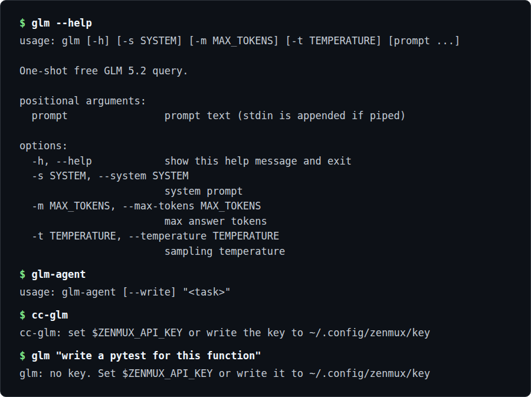

# glm-free-claude-code

Use the **free GLM 5.2 API** with [Claude Code](https://claude.com/claude-code): three small, dependency-free command-line tools for running a whole session on GLM, or for offloading cheap work and whole tasks to it from a paid session. No API key from Anthropic, no paid gateway, no `pip install`. GLM 5.2 is Z.ai's open-weights coding model; ZenMux exposes a free tier of it on an Anthropic- and OpenAI-compatible endpoint.



*The `glm` help text, then the `glm-agent` usage line and the "no key" message from `cc-glm` and `glm` before a ZenMux key is set.*

---

## Get a free key (one minute)

1. Go to **https://zenmux.ai** and sign in.
2. Open **Models**, pick **GLM 5.2 Free** (the `z-ai/glm-5.2-free` variant, *not* the paid one).
3. **Create API Key**, copy it.
4. Store it once:
   ```bash
   mkdir -p ~/.config/zenmux && umask 177 && printf '%s' 'YOUR_KEY_HERE' > ~/.config/zenmux/key
   ```
   (All three tools also accept `export ZENMUX_API_KEY=...` instead of the file.)

> If inference returns `403 access_denied` while the models list works, your ZenMux
> account isn't entitled for the free model yet — finish account activation /
> email-verify in the dashboard and create a fresh key. That's an account setting,
> not a bug in these scripts.

---

## Install

```bash
git clone https://github.com/Matswm86/glm-free-claude-code.git
cd glm-free-claude-code

# the offload CLI + headless agent
install -m 755 glm glm-agent ~/.local/bin/   # ~/.local/bin must be on PATH

# the session launcher
echo "source $(pwd)/cc-glm.sh" >> ~/.bashrc   # or ~/.zshrc; open a new terminal
```

---

## What it does

- **`cc-glm`**: launch a whole Claude Code session driven by free GLM 5.2.
- **`glm`**: a one-shot CLI so a session running on a *paid* model (e.g. an Opus Max-subscription session) can **offload** cheap/bulk work to free GLM, keeping the expensive model as the orchestrator.
- **`glm-agent`**: a *headless* GLM Claude Code agent (`claude -p` pointed at GLM) for handing a whole self-contained, multi-step task to GLM (it reads, greps, runs Bash, optionally edits files) while your paid session reviews the result.

---

## How it works

`glm` is a single Python 3 file that uses only the standard library: it posts a chat-completions request for the `z-ai/glm-5.2-free` model to ZenMux's OpenAI-compatible endpoint, retries on rate limits and strips any `<think>` block from the answer. `cc-glm` is a bash function and `glm-agent` a bash script; both point Claude Code at ZenMux's Anthropic-compatible endpoint by setting `ANTHROPIC_BASE_URL` and mapping the opus, sonnet and haiku tiers to GLM 5.2 free, then run `claude` (interactive for `cc-glm`, `claude -p` for `glm-agent`). `cc-glm` runs in a subshell so those settings never leak into your normal paid session. `glm-agent` allows Read, Glob, Grep and Bash, and adds Edit and Write (with the accept-edits permission mode) only under `--write`. All three take the key from `ZENMUX_API_KEY` or `~/.config/zenmux/key`.

---

## Status

Three small scripts, no tagged release and no automated test suite yet.

---

## Usage

### A. A full GLM 5.2 session
```bash
cc-glm
```
Everything in that terminal runs on free GLM 5.2. Run your normal `claude` (paid/subscription) in a *separate* terminal.

### B. Offload from a paid session
Inside any session (or any shell):
```bash
glm "write a pytest for this function"          # prompt as arg
cat big.log | glm "summarise the errors"        # pipe stdin in
glm -s "code only, no prose" "debounce in TS"   # system prompt
glm -m 8000 "long refactor plan for ..."        # bigger answer budget
```
The pattern: let the expensive model **plan and review**, and have it shell out to `glm` for the mechanical bulk (boilerplate, summaries, first drafts, long-context grunt work). Cheap half is free.

### C. Hand a whole task to a headless GLM agent
```bash
glm-agent "summarise what each file in ./src does"     # no Edit/Write tools
glm-agent --write "add type hints to utils.py"         # may edit/write files
```
`glm-agent` runs `claude -p` pointed at GLM, so the entire agent loop (read/grep/Bash, and with `--write`, Edit/Write) runs on free GLM. By default it has no Edit/Write tools, but Bash is not restricted, so a task can still change files through shell commands; `--write` adds Edit/Write (review the diff: GLM is weaker than a frontier model). Good for delegating a self-contained chunk while your paid session stays free for judgment.

---

## Why not one terminal that auto-routes Opus + GLM?

Tools like [claude-code-router](https://github.com/musistudio/claude-code-router) route different request types to different models inside a single Claude Code session. They work great **if you pay per-API-key for every provider**, including Anthropic.

They do **not** work with a Claude **Pro/Max subscription**: the subscription only authenticates through Claude Code's own OAuth against the real Anthropic endpoint. The moment any router/proxy sits in front, Claude Code stops using the subscription, and a router needs an Anthropic *API key* (metered, paid) for the Opus leg. So "auto-route Opus + GLM in one terminal" and "free Opus via subscription" are mutually exclusive.

That's the whole reason for the three-tool, two-terminal design here: subscription-Opus stays untouched in its own terminal; free GLM does the rest.

---

## Caveats

- **No vision.** GLM 5.2 is text-only — image/screenshot inputs won't work. Keep those on a multimodal model.
- **Rate limits.** The free tier has unspecified limits and will `429` under heavy load; `glm` backs off and retries automatically (up to twice).
- **Reasoning model.** GLM 5.2 spends reasoning tokens that count against `max_tokens`; `glm` pads the budget so the answer isn't truncated. Raise it with `-m` / `ZENMUX_REASONING_OVERHEAD` for big outputs.

## License

MIT — see [LICENSE](LICENSE).
